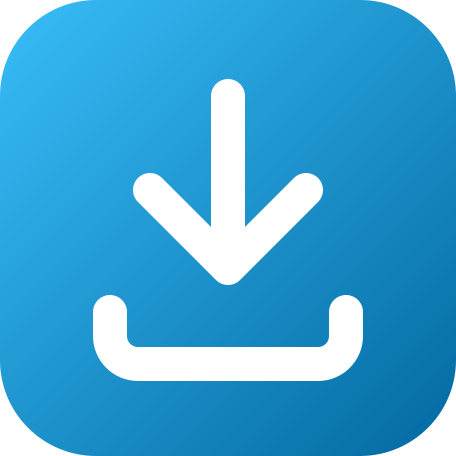
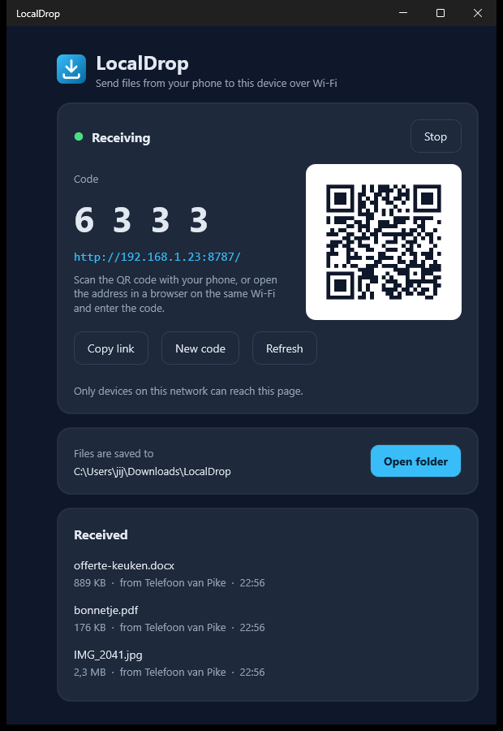
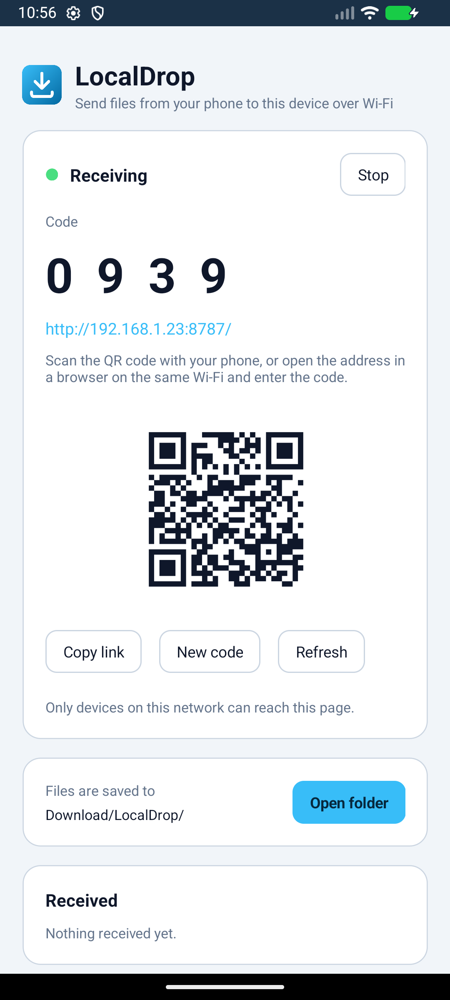
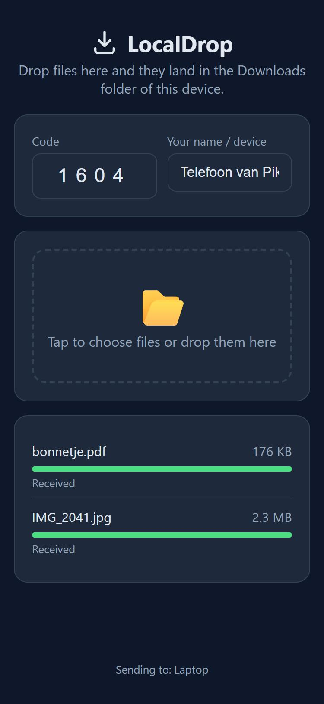

<p align="center">
  
</p>

<h1 align="center">LocalDrop</h1>

<p align="center">
  Bestanden van je telefoon naar je laptop sturen (of andersom) via je eigen wifi.<br>
  Geen WhatsApp-naar-jezelf, geen cloud, geen account. Gewoon: QR scannen, bestand slepen, klaar.
</p>

<p align="center">
  <a href="https://github.com/PiMo131/LocalDrop/releases/latest/download/LocalDrop-Setup-1.0.0.exe"><b>⬇️ Download voor Windows</b></a>
  &nbsp;&nbsp;·&nbsp;&nbsp;
  <a href="https://github.com/PiMo131/LocalDrop/releases/latest/download/LocalDrop-1.0.0.apk"><b>⬇️ Download voor Android (APK)</b></a>
  &nbsp;&nbsp;·&nbsp;&nbsp;
  <a href="https://github.com/PiMo131/LocalDrop/releases/latest">Alle versies</a>
</p>

---

## Wat doet het?

Je zet LocalDrop aan op het apparaat dat bestanden moet **ontvangen** (meestal je laptop). LocalDrop laat dan een QR-code en een 4-cijferige code zien. Op je telefoon scan je de QR-code; er opent een simpele webpagina waar je foto's, PDF's of wat dan ook naartoe sleept. Een paar seconden later staan ze in de map **Downloads\LocalDrop** op je laptop.

Het werkt ook andersom: zet LocalDrop aan op je telefoon en stuur vanaf je laptop.

| Op je laptop (Windows) | Op je telefoon (Android) | De pagina waar je bestanden heen sleept |
|:---:|:---:|:---:|
|  |  |  |

> Alles blijft binnen je eigen wifi-netwerk. Er gaat niets naar internet.
>
> De app is Nederlands als je Windows of Android in het Nederlands staat, anders Engels (zoals op de screenshots hierboven).

## Installeren

### Windows (10 of 11)

1. Download [`LocalDrop-Setup-1.0.0.exe`](https://github.com/PiMo131/LocalDrop/releases/latest/download/LocalDrop-Setup-1.0.0.exe).
2. Dubbelklik op het bestand. Windows kan een blauw venster tonen met *"Windows heeft uw pc beschermd"* (SmartScreen). Dat komt omdat de installer niet digitaal ondertekend is. Klik op **Meer informatie** en dan op **Toch uitvoeren**.
3. Volg de stappen. Vink **LocalDrop automatisch starten met Windows** aan als je wilt dat hij altijd klaarstaat (hij start dan onzichtbaar in het systeemvak, rechtsonder bij de klok).
4. Bij de eerste start kan Windows Firewall vragen of LocalDrop netwerktoegang mag. Vink **Particuliere netwerken** aan en klik op **Toegang toestaan**. Zonder dit kan je telefoon de laptop niet bereiken.

### Android (10 of nieuwer)

1. Open deze pagina op je telefoon en tik op [`LocalDrop-1.0.0.apk`](https://github.com/PiMo131/LocalDrop/releases/latest/download/LocalDrop-1.0.0.apk).
2. Open het gedownloade bestand (via de melding bovenin, of via de app *Bestanden* → *Downloads*).
3. Android vraagt of je browser apps mag installeren uit onbekende bron. Sta dat toe (dit is normaal voor apps buiten de Play Store).
4. Tik op **Installeren**. Bij de eerste start vraagt LocalDrop of hij meldingen mag sturen; dat is handig om te zien wanneer er iets binnenkomt.

### iPhone / Mac

Er is nog geen app voor iPhone of Mac. Maar: **een iPhone kan wél bestanden sturen naar een laptop of Android-telefoon waar LocalDrop op draait**, gewoon via Safari. Scan de QR-code met de camera-app en je zit op de drop-pagina.

## Gebruiken

1. **Start LocalDrop** op het apparaat dat moet ontvangen. Je ziet "Ontvangt" met een groen bolletje, een grote code en een QR-code.
2. **Scan de QR-code** met de camera van je telefoon (of open het adres dat eronder staat, bijvoorbeeld `http://192.168.1.23:8787`, in een browser op een apparaat op dezelfde wifi).
3. De drop-pagina opent. Als je de QR-code hebt gescand, is de code al ingevuld. Anders typ je de 4 cijfers over.
4. **Tik op de map** om bestanden te kiezen, of sleep ze erheen vanaf een computer. Je kunt meerdere bestanden tegelijk kiezen.
5. Per bestand zie je een groen balkje als het binnen is. Op de ontvanger verschijnt een melding, en het bestand staat in:
   - Windows: `Downloads\LocalDrop\<naam van de afzender>\`
   - Android: `Download/LocalDrop/<naam van de afzender>/` (zichtbaar in de app *Bestanden* of *Downloads*)

De naam van de afzender vul je zelf in op de drop-pagina (bijvoorbeeld "Telefoon van Pike"); hij wordt onthouden voor de volgende keer.

### Handige knoppen

| Knop | Wat het doet |
|---|---|
| **Link kopiëren** | Kopieert het adres inclusief code, om bijvoorbeeld in een chat te plakken. |
| **Nieuwe code** | Maakt een nieuwe 4-cijferige code. Doe dit als iemand de oude heeft gezien die je niet vertrouwt. |
| **Vernieuwen** | Zoekt opnieuw het IP-adres op, handig na wisselen van wifi-netwerk. |
| **Map openen** | Opent de map waar de bestanden staan. |
| **Stop** | Zet het ontvangen uit. Niemand kan dan nog iets sturen. |

### Systeemvak (Windows)

Als je het venster sluit, blijft LocalDrop draaien in het systeemvak (rechtsonder, misschien achter het pijltje ˄). Rechtsklik op het icoontje voor **LocalDrop tonen**, **Map openen** of **Afsluiten**. Alleen *Afsluiten* stopt het programma echt.

## Veelgestelde vragen

**Mijn telefoon kan de pagina niet openen.**
Controleer of telefoon en laptop op *dezelfde* wifi zitten. Op kantoor-wifi of gastnetwerken is het verkeer tussen apparaten soms geblokkeerd; dan werkt het niet. Een hotspot vanaf je telefoon werkt wel: verbind de laptop met de hotspot van je telefoon.

**Windows vroeg niets over de firewall en het werkt niet.**
Open *Windows-beveiliging* → *Firewall en netwerkbeveiliging* → *Een app toestaan via firewall* en vink LocalDrop aan voor *Particulier*. Of draai de installer opnieuw als beheerder; die zet de regel dan automatisch.

**Is dit veilig?**
Alleen apparaten op je eigen netwerk kunnen de pagina openen, en zonder de 4-cijferige code kan niemand iets sturen. Na 5 foute codes wordt een apparaat een minuut geblokkeerd. Bestandsnamen worden opgeschoond, zodat niemand buiten de LocalDrop-map kan schrijven. Verkeer gaat onversleuteld (http) maar verlaat je netwerk niet.

**Kan ik ook bestanden van de laptop naar mijn telefoon halen?**
Niet via dezelfde pagina. Start LocalDrop op je telefoon en stuur vanaf de laptop (open het adres in je browser).

**Waarom een APK en geen Play Store?**
Publiceren in de Play Store kost tijd en geld; voor nu is sideloaden de snelste weg. Een iPhone-versie vereist een Mac en een Apple-ontwikkelaarsaccount.

**Welke poort gebruikt het?**
8787. Als die bezet is, pakt LocalDrop automatisch 8788, 8789, enzovoort.

## Zelf bouwen (voor ontwikkelaars)

LocalDrop is een .NET MAUI-app (C#). Eén codebase voor Windows en Android.

Vereisten: .NET 8 SDK met `maui`-workload, Microsoft OpenJDK 17, Android SDK (platform 34, build-tools 35+), Inno Setup 6.

```powershell
.\build.ps1            # Windows installer + Android APK -> .\dist\
.\build.ps1 -Windows
.\build.ps1 -Android
```

Snel draaien tijdens ontwikkelen:

```powershell
dotnet build LocalDrop\LocalDrop.csproj -f net8.0-windows10.0.19041.0 -t:Run
```

Voor een ondertekende Android-APK: kopieer `LocalDrop/Signing.props.example` naar `Signing.props`, maak een keystore met `keytool` en bewaar die goed. Alleen een APK met dezelfde sleutel kan over een bestaande installatie heen.

### Hoe het werkt

- **Server**: [EmbedIO](https://github.com/unosquare/embedio) (managed HTTP-listener, geen adminrechten nodig) op poort 8787.
- **Alleen LAN**: verzoeken van adressen buiten de privéreeksen (10.x, 172.16-31.x, 192.168.x, link-local) krijgen 403.
- **Upload**: `PUT /upload?name=<bestand>` met headers `X-Pin` en `X-Sender`, body = ruwe bytes. Streamt direct naar schijf; botsende namen krijgen ` (2)`, ` (3)` enz.
- **Windows**: tray via H.NotifyIcon, toast via Windows Community Toolkit, venster verbergen in plaats van sluiten, `--minimized` voor autostart.
- **Android**: foreground service houdt server en wifi wakker; opslag via MediaStore, dus geen opslagpermissie nodig.
- **Taal**: Nederlands als de systeemtaal `nl-*` is, anders Engels. De drop-pagina volgt de browsertaal.
- **Demo-modus** (voor screenshots): omgevingsvariabele `LOCALDROP_DEMO=1` of op Android `adb shell setprop debug.localdrop.demo 1` toont nepadressen.

```
LocalDrop/
  Services/DropServer.cs      webserver + pincode + LAN-check
  Services/NetUtil.cs         IP-detectie, LAN-check, naam-opschoning
  Services/IFileSink.cs       opslag-abstractie + INotifier
  MainViewModel.cs, MainPage.xaml
  Resources/Raw/drop.html     de webpagina die de telefoon ziet
  Platforms/Windows/          tray, toast, Downloads-map, venster verbergen
  Platforms/Android/          MediaStore, notificaties, foreground service
installer/LocalDrop.iss       Inno Setup-script
build.ps1                     bouwt alles naar dist\
```

## Licentie

MIT, zie [LICENSE](LICENSE).
